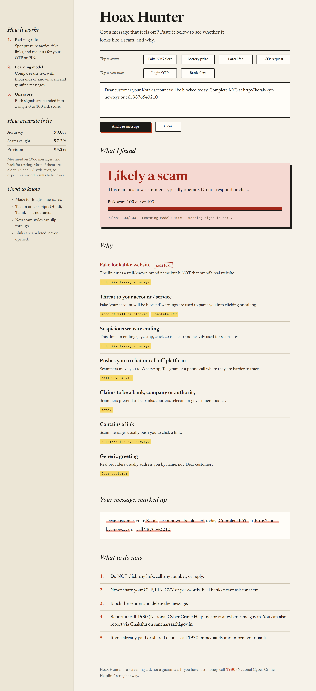
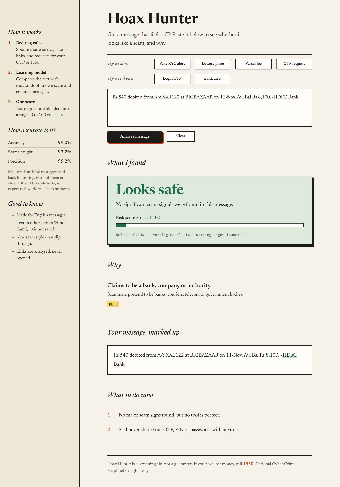
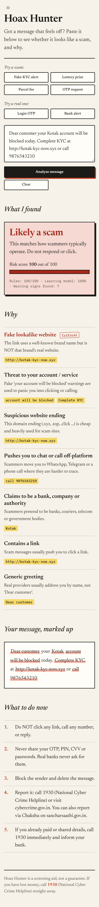
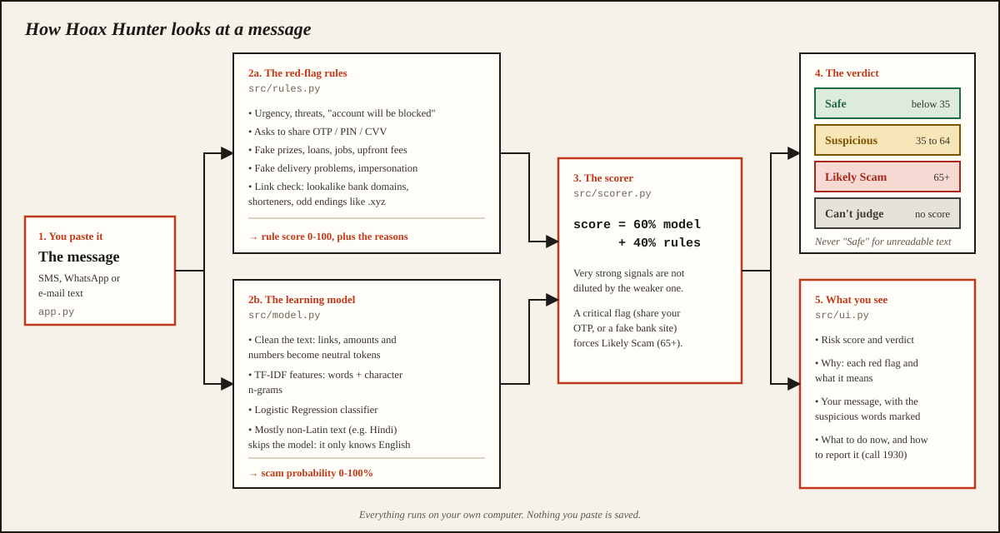
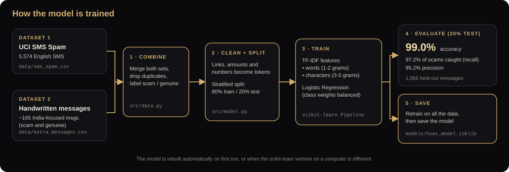

# 🕵️ Hoax Hunter

Paste a suspicious SMS, WhatsApp message or email and Hoax Hunter tells you if it looks like a scam, with a **0-100 risk score**, the **red flags** it found, the **suspicious words highlighted**, and **what to do next**. Built for parents and grandparents, and everyone else who gets "your KYC is expiring" messages.

**Built with:** Python · Streamlit · scikit-learn · Pandas · pytest

| Likely scam | Looks safe | On a phone |
| :---------: | :--------: | :--------: |
|  |  |  |

## Features

- **Risk score and verdict:** Safe, Suspicious or Likely Scam, with a 0-100 score.
- **Explainable:** every red flag says *why* it was raised, and suspicious words are highlighted in the message.
- **India-focused:** understands fake KYC and bank alerts, OTP / PIN requests, prize and loan offers, fake delivery problems, lookalike bank links such as `sbi-kyc-update.xyz`, and points you to the 1930 cyber-crime helpline.
- **Private:** messages are analysed on your own computer and never stored.
- **One-command launcher:** `run.py` sets up everything and opens the app.
- **Tested:** unit tests for the rules, model, scorer and highlighter, plus headless UI tests.

## How it works



Two detectors are combined into one score:

| Layer | What it does | Why |
| --- | --- | --- |
| **Red-flag rules** (`src/rules.py`) | Looks for scam tricks: urgency, fake prizes, requests to share OTP/PIN, account-block threats, upfront fees, fake loan/job offers, fake delivery problems, and **lookalike links** (shortened links, fake bank domains) | Explainable: every flag says *why* |
| **ML model** (`src/model.py`) | TF-IDF + Logistic Regression trained on the UCI SMS Spam Collection plus ~165 handwritten India-focused English messages | Catches wording the rules don't cover |

`src/scorer.py` blends them: **60% model + 40% rules**. Two safety rules sit on top:

- A **critical flag** (asking you to *share* your OTP/PIN, or a fake bank website) always gives **Likely Scam**, because no genuine sender ever does that.
- A very strong rule score or a very confident model is not diluted by the other, weaker signal.

Verdicts: **Safe** (below 35), **Suspicious** (35-64), **Likely Scam** (65 and above).

## Get the code

```bash
git clone https://github.com/Sanjay021fyrd/Hoax-Hunter.git
cd Hoax-Hunter
```

No git? Click the green **Code** button on GitHub and choose **Download ZIP**, then unzip it.

## Run it

The only thing to install by hand is **Python 3.10 or newer** from [python.org/downloads](https://www.python.org/downloads/). On Windows, tick **"Add python.exe to PATH"** in the installer. Everything else installs itself.

| System | Command |
| --- | --- |
| macOS / Linux | `python3 run.py` |
| Windows | `py run.py` (or `python run.py`) |

The first run creates a private environment, installs the libraries (about 1-2 minutes, needs internet once), trains the model (a few seconds) and opens the app in your browser at <http://localhost:8501>. Later runs start in seconds. Press `Ctrl+C` in the terminal to stop.

### Manual way (if you prefer)

```bash
python3 -m venv .venv
source .venv/bin/activate          # Windows: .venv\Scripts\activate
pip install -r requirements.txt
streamlit run app.py
```

### Useful extras

```bash
python -m src.model     # retrain the model yourself and print its quality report
python -m pytest        # run the tests
PORT=9000 python3 run.py   # use another port (Windows PowerShell: $env:PORT=9000; py run.py)
```

To open it on your phone or another laptop, start the app and open the **Network URL** Streamlit prints (like `http://192.168.x.x:8501`) on any device on the same Wi-Fi.

### Troubleshooting

- **`python` not found** (Windows): use `py run.py`, or reinstall Python with "Add to PATH" ticked.
- **"needs Python 3.10 or newer"**: install a newer Python from python.org.
- **Install fails / no internet**: connect once so the libraries can download.
- **Port already in use**: run with another port, e.g. `PORT=9000`.
- **Streamlit asks for an email** (only when started manually): just press Enter.

## Project layout

```
run.py                  one-command launcher (sets everything up, then starts the app)
app.py                  Streamlit page (layout + wiring)
assets/style.css        the plain paper-and-ink theme (large, readable text)
.streamlit/config.toml  theme colours / Streamlit settings
src/ui.py               HTML building blocks (verdict card, evidence cards, ...)
src/rules.py            red-flag rules + link analysis
src/model.py            ML training and prediction
src/scorer.py           combines rules + model into a verdict
src/highlight.py        safe HTML highlighting of suspicious text
src/data.py             dataset download / loading
data/extra_messages.csv handwritten scam + genuine messages (India-focused)
tests/                  unit tests + headless UI tests
```

## How the model is trained



## How good is it?

On 1,066 messages held back for testing (the model learns from the other 80%): **99.0% accuracy, 97.2% of scams caught (recall), 95.2% precision**, with 7 false alarms and 4 missed scams. The model you run is then retrained on all the data.

Be realistic about this number: most of that test data is older UK/US-style SMS, which flatters the model. A tougher check lives in `tests/holdout_messages.py`: 24 fresh India-style English messages written after the model and rules were built.

| Fresh messages | Scams (12) | Genuine (12) |
| --- | --- | --- |
| Result | 9 *Likely Scam*, 3 *Suspicious*, none missed | all 12 *Safe* |

This set is small and was used to find gaps, so treat it as a sanity check, not proof. Expect real-world accuracy to be lower.

## Languages

Hoax Hunter is built for **English** messages.

| Text | What happens |
| --- | --- |
| English | Fully supported |
| Any non-Latin script (Hindi, Tamil, Arabic, Chinese, ...) | **Not rated.** The app says *"Can't judge this one"* instead of guessing. Links and numbers are still checked, so a fake bank link is still caught |
| Other languages written in English letters (Hinglish, Spanish, ...) | Analysed as if they were English, so results are unreliable |

## Limitations

- Scammers keep changing wording; new styles can slip through. Retrain with new examples regularly.
- It does **not** open or scan links, check phone numbers, or look at images.
- The list of official bank/brand domains in `src/rules.py` is small and should be extended.
- It's a helper, not a guarantee. If unsure, open the official app yourself or call **1930**.

## Privacy

Messages are analysed on the computer that runs the app. Nothing you paste is saved to disk, and the app collects no usage statistics. When you are online the page loads two fonts from Google Fonts (this never includes your message). If you deploy the app online, pasted messages are sent to the server that hosts it.

## Data and credits

- **SMS Spam Collection v.1** (5,574 English SMS), from the [UCI Machine Learning Repository](https://archive.ics.uci.edu/dataset/228/sms+spam+collection). Collected by T. A. Almeida and J. M. Gómez Hidalgo from the Grumbletext forum, Caroline Tagg's PhD thesis and the NUS SMS Corpus. Paper: Almeida, Gómez Hidalgo and Yamakami (2011), *Contributions to the Study of SMS Spam Filtering: New Collection and Results*, ACM DocEng. If you reuse the data, follow the terms on the dataset page.
- `data/extra_messages.csv` was written for this project. Its phone numbers and links are made up.

## Report a scam (India)

- National Cyber Crime Helpline: **1930** (call immediately if you lost money)
- [cybercrime.gov.in](https://cybercrime.gov.in)
- Chakshu on [sancharsaathi.gov.in](https://sancharsaathi.gov.in) to report suspected fraud calls/SMS

## Ideas for next steps

- Let users flag wrong results and append them to the training data
- OCR so screenshots of messages can be checked
- Check links against a phishing blocklist
- Support more languages (needs labelled training data)
- Deploy on Streamlit Community Cloud

## Author

**T.M. Sanjay Kumar** · [GitHub](https://github.com/Sanjay021fyrd) · [LinkedIn](https://www.linkedin.com/in/sanju-t-)
